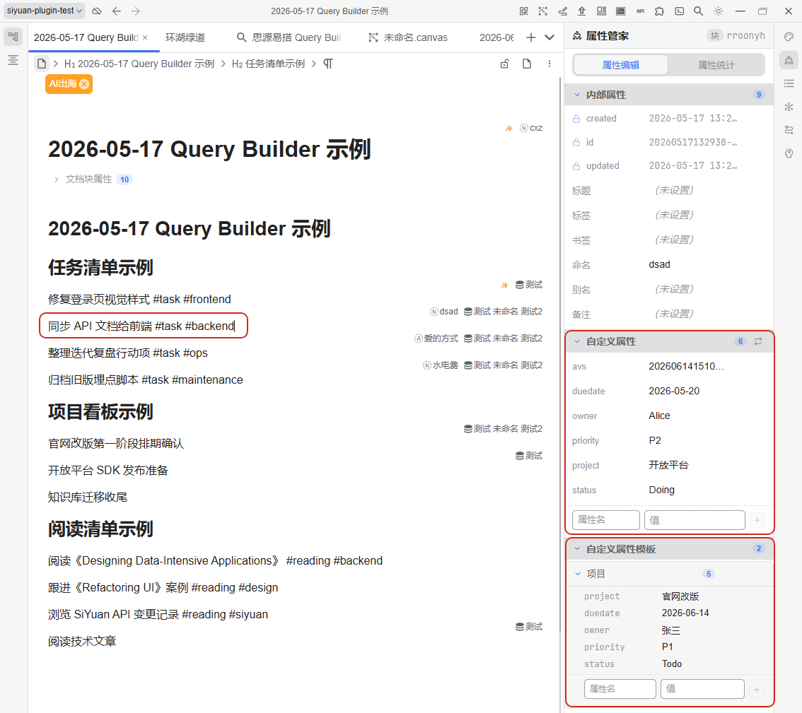
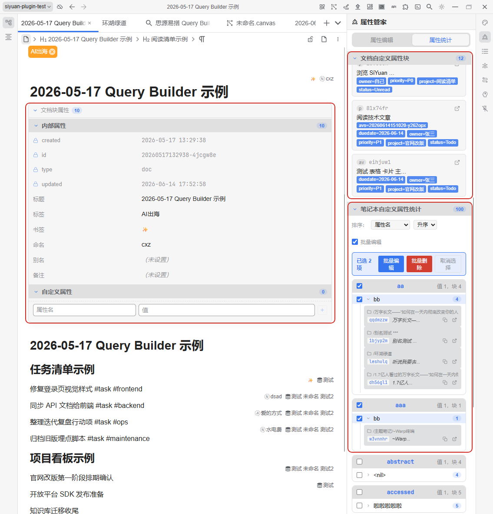
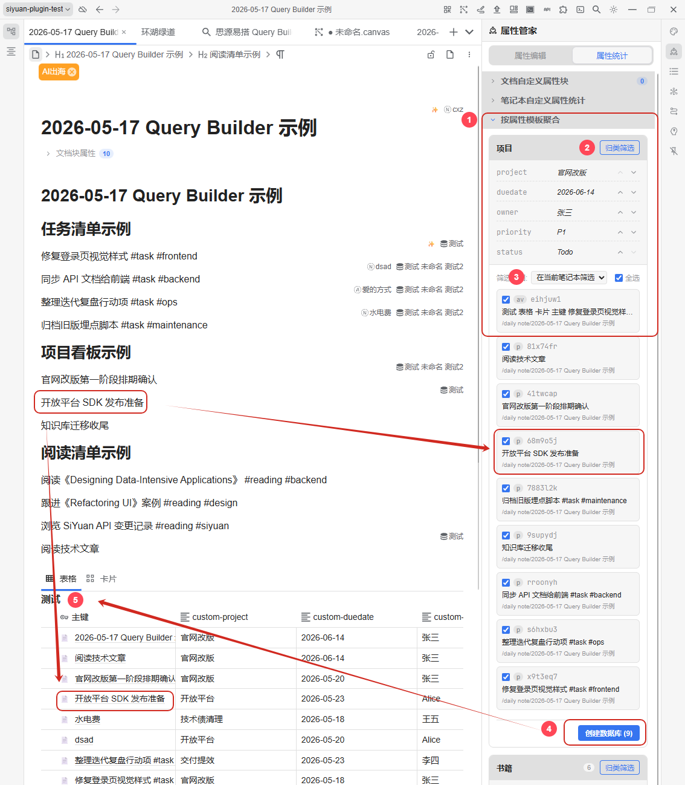

# “块属性”向上，“数据库”向下，你是否也曾困惑该何去何从？

## 楔子

我在思源笔记里管理一个项目，习惯是这样的：任务都是文档里的列表项，写完一条任务就在块标菜单里点"属性"，加上 ​`custom-status=doing`​、​`custom-priority=P1`，再用 SQL 嵌入块把这些任务捞出来，拼出一个简陋的看板。

后来官方数据库（属性视图）上线了，表格、看板、画廊看起来都很不错。我兴冲冲建了一张"任务库"，把块一条条拖进去——然后发现了一个让人难受的地方：**块上原有的属性，并没有自动变成表格里的"状态"、"优先级"列的值**。我只好在表格里重新填一遍。于是同一条任务，块属性里写着 ​`status=doing`，数据库单元格里填着"进行中"，两周之后两边就对不上了。改了这头忘那头，最后我自己都不知道哪个是准的。

还有一个反向的困惑：读书时记了些笔记，想给它记个主题和评个分，难道要先建一张"笔记库"、设计好列、再把块收进去？有时候我想要的其实只是一个文档级的属性而已。社区论坛上曾经有个帖子中的一句话让我印象深刻： **"很多时候只是需要一个文档 frontmatter，却被迫去创建了思源的数据库。"**

困惑了几个月之后，我决定把块属性和数据库这两样东西认真理一遍。以下是我分析后的一些理解，若有错误请大家指正。

‍

## 概念辨析：块属性 vs 数据库

### 块属性：挂在块身上的键值对

块属性是附着在**单个内容块上的** ​**​`key=value`​**​ **元数据**。你在块标菜单里设置一个自定义属性，思源会自动给它加上 ​`custom-`​ 前缀，然后把它写进这个块的 IAL（行内属性列表）——也就是直接落在 ​`.sy`​ 文件里的块数据上，同时进入 SQLite 的 ​`attributes`​ 索引表，供 SQL 查询。

它有三个决定性特征：

1. **数据跟块走**。属性就长在块自己身上，块被移动、复制、块引用、嵌入到任何地方，属性始终跟着块，不依赖任何外部容器。
2. **全都是字符串**。​`priority=3`​、​`priority=高`​、​`priority=P1` 都能写进去，这是自由，也是困扰的来源。
3. **写入即存在，写空即删除**。把某个属性值改成空字符串，这个属性就从块上消失了。

### 数据库（属性视图）：独立的结构化数据容器

数据库则是一套**独立于文档块的结构化数据**：字段（列）、条目（行）、视图（表格/看板/画廊）。数据存放在独立的 ​`.av`​ 文件里，文档中的"数据库块"只是一个指向它的挂载点。字段有明确类型——文本、数字、单选、多选、日期、复选框、资源、关联、模板、汇总等，同一个数据库可以建多个视图，各自有独立的筛选、排序、分组。

数据库的条目可以**绑定**到内容块——绑定之后，块上会多出 ​`custom-avs` 这样的内核托管标记，这条记录就"锚"在了笔记里：点开块能跳到表格行，双链体系里它也是一个正式节点。

### 一张表看清区别

|维度|块自定义属性|数据库（属性视图）|
| :-------| :---------------------------| :-------------------------------|
|本质|块身上的键值元数据|字段 + 条目 + 视图的结构化集合|
|存储|块的 IAL（`.sy` 内）+ SQLite 索引|独立的 `.av` 文件|
|类型|弱类型，全是字符串|强类型字段，可校验、可计算|
|跟随性|数据跟块走，永不脱离|数据在库里，条目绑定块后才有锚点|
|覆盖范围|全库任意块，随手可加|只管自己库内的行|
|能力上限|SQL 查询、轻量筛选|排序/筛选/汇总/关联/多视图|
|典型用途|给摘录、灵感、任务打标|任务库、项目库、文献库、资产台账|

一句话概括：**块属性是"块的元数据"，数据库是"结构化数据容器"；块属性偏源头打标，数据库偏终态看板**。两者不是竞争关系，而是同一条数据流水线的上下游——但联系两者的桥还不完善，这也是我为什么会为两者体现为分离的"两张皮"而困惑。

‍

## 使用场景：什么时候用哪个？

### 三类典型场景

**场景 A：轻量打标 + 检索 —— 用块属性。**  读书摘录的主题和评分、卡片笔记的状态、散落在各处的临时 TODO、会议纪要里的行动项。这类标记的特点是：内容先出现，结构后想清楚；数量不确定；同一套属性会打在异构的块上（摘录、代码块、段落都能打 `topic=ai`）。先建表再填内容纯属自找麻烦，属性 + SQL 才是顺势的写法：

```sql
SELECT b.id, b.content, a.value
FROM blocks b
JOIN attributes a ON b.id = a.block_id
WHERE a.name = 'custom-status' AND a.value = 'doing'
```

**场景 B：稳定对象的长期管理 —— 用数据库。**  任务库、项目库、工具资产库、账号台账、内容选题库。判断信号有三个：**同构**（每条记录都有状态、日期、负责人这些稳定字段）、**持续变化**（状态会推进、日期会更新）、**需要多视角**（既要表格总览，也要看板执行、按日期排期）。一旦你在反复问"所有 X 里哪些满足 Y、按 Z 排序"，就该建库了。

**场景 C：从 A 长到 B —— 这才是大多数人会经历的真实路径。**

### 我推荐"自底向上"路线：从块属性到数据库

我的教训是：早期被数据库的漂亮界面吸引，什么都想建库，结果建了七八张表，schema 没想清楚，维护不动，全荒废了。反过来才是顺势的：

```text
1. 捕捉层：写作时用少量块属性轻量打标（status / topic / priority）
            —— 不打断心流，不想清楚结构也能记
2. 积累层：定期看一眼属性统计，发现命名漂移、取值混乱就批量纠正
            —— 让属性体系慢慢"长"稳定
3. 治理层：维度稳定、规模上来之后，把带同一组属性的块聚合成数据库
            —— 字段直接来自属性模板，存量属性回填成单元格
4. 运行层：建库后状态类信息在数据库里维护（看板/日期/汇总），
            属性侧靠双向同步保持一致；块属性继续承担"库外自由打标"
```

这样做的好处是：**结构是从真实记录里长出来的，而不是凭空设计的**。你在捕捉层积累的每一个属性值，到了治理层都直接变成数据库里的数据，没有白费的功夫。什么时候该升级到数据库？当某个模板的属性集你已经三个月没改过结构、块数超过两屏、开始想念看板和排序的时候——从块属性到数据库是水到渠成的过程。

反过来说，如果一开始就是任务管理、资产台账这种生命周期稳定的对象，直接建库（路线 B）也完全合理，不必教条。

### 两个容易翻车的坑

**坑一：拖块进库，属性不会跟进去。**  把一个已经带 `custom-status=doing` 的块拖进数据库，单元格不会自动填上"doing"——内核压根不会去读块上的 IAL。这是"两张皮"的直接来源。官方较新版本加入了数据库自动化收集（按标签、自定义属性、文档范围等条件自动收块，并用模板赋初值），"收哪些块"这个问题有了原生解法；但"已有属性值如何翻译成单元格值、之后两边如何保持一致"，仍然没有官方答案。

**坑二：命名漂移，后聚合翻车。**  今天写 ​`custom-status`​，明天顺手写成 ​`custom-state`​；值一会儿 ​`high`​、一会儿 ​`高`​、一会儿 ​`P1`​。等到想聚合的时候，SQL 一查全是碎片。我的习惯是：键名固定一套小写集合（status/priority/due/topic）；取值用固定英文枚举（todo/doing/done）；日期一律 ​`YYYY-MM-DD`，多选分隔符统一用逗号。最好再配合工具的批量重命名功能兜底——人总会手滑。

‍

## 用"属性管家"补上思源现状的不足


### 思源笔记原生实现的几个短板

把前面的坑归拢一下，当前思源在"块属性 → 数据库"这条路上主要缺五样东西：

1. **属性编辑入口深**：只能从块标菜单进，没有常驻面板，高频打标非常打断写作（官方也讨论过原生属性面板，暂无计划）；
2. **纯文本散装录入**：自定义属性没有类型、没有选项池、没有联想，`status` 拼成 `statu` 照样存进去，发现时已经污染了一堆块；
3. **属性黑盒**：全库沉淀了哪些属性、哪些值写错了、哪些块打了标，没有一个全局视图，只能自己写 SQL 排查；
4. **建库前置成本高**：必须先设计字段再填内容，行与文档的绑定模型也让"我就想要张轻量表"的用户困惑；
5. **属性与数据库之间没有桥**：拖块不带属性、两侧各自为政，SQL 也查不到数据库字段。

### 属性管家v1.0 做的事

"属性管家"插件是我围绕这条路径做的工具，基本就是对着上面的短板进行补齐：

- **常驻属性面板。**  侧边栏 Dock 随光标实时跟随，点到哪个块就显示哪个块的属性，就地编辑、失焦即存；文档标题和正文之间还可以嵌入一条内联属性栏，不打断排版。移动端的底部抽屉也已经实现，待端点放开后随版本启用。

  
- **统计看板与批量重构。**  文档级和笔记本级两级统计：每个属性有多少取值、覆盖多少块，一目了然；展开就下钻到具体的块（带文档路径面包屑和内容摘要），点击跨文档跳转高亮。勾选若干属性值就能批量重命名或批量清理——这是积累层"纠偏"动作的执行器。

  
- **按模板一键建库。**  这是"水到渠成"那一步：选定一个属性模板，插件自动在当前文档或全笔记本范围内聚合带有这套属性的块，勾选后一键生成思源原生数据库——绑定块作为行。

  

### 属性管家v2.0 预告

在 属性管家v1.0 基础上，近期 v2 版本开发主要聚焦于以下特性：

- **类型化属性体系（Schema）。**  这是告别"散装字符串"的关键：全局 Schema 注册表把 ​`custom-*` 键映射到 7 种类型——文本、数字、单选、多选、日期、布尔、块关联，后面建数据库时可以无缝对应。改属性名时可以选择全库改写旧键，命名漂移一次纠正到位。
- **属性 ⇄ 数据库双向同步。** 建库时自动登记同步，之后在属性面板改属性，数据库单元格即时更新；在数据库里编辑单元格，块属性实时回写。

合起来，我的工作流变成了：**写（自由记录）→ 标（类型化轻打标）→ 看（统计纠偏）→ 聚（一键建库）→ 同步（两侧一致）** 。块属性和数据库不再是二选一，而是同一条流水线的两段。

‍

## 让结构自己长出来

知识管理是一个渐进过程，工具应该跟着记录走，而不是让记录迁就工具。

我自己尝试的工作流浓缩成一句话：**轻量打标不建表，维度稳定再建库，建库之后靠同步**。先用块属性让元数据"长"出来，用统计和批量工具守住命名纪律，等某个领域的结构真的稳定了，再一键升格为数据库——到那时你会发现，之前打标的每一分钟都没有白费，它们就是表格里现成的数据。

自由笔记、块属性、数据库、SQL、双链，从来不是非此即彼。好的知识管理系统应该像生态系统：有荒野（自由文本），有田地（属性打标），也有城市（数据库看板）——而中间的路，应该越走越顺。

感谢思源笔记提供的这片天地。

‍

## 附录

- [属性管家：自底向上的维护属性，水到渠成时构建数据库 - 链滴](https://ld246.com/article/1781848253163)  *
- [为了让思源笔记用起来更顺手，我打算开发 10 个插件，目前进度…… - 链滴](https://ld246.com/article/1775894033664) *

‍
