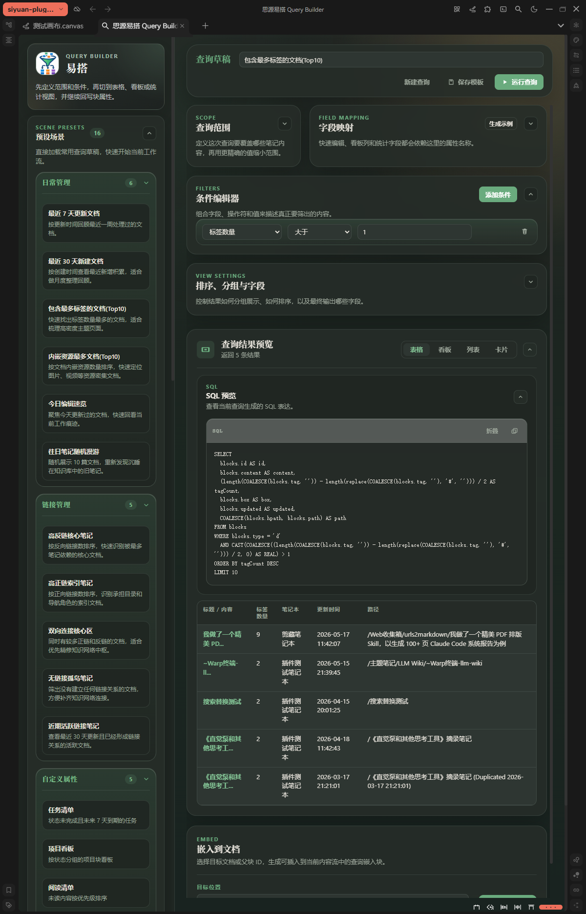
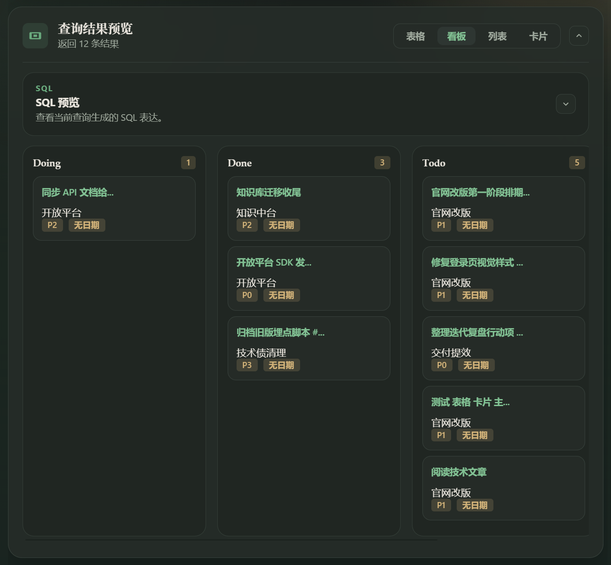
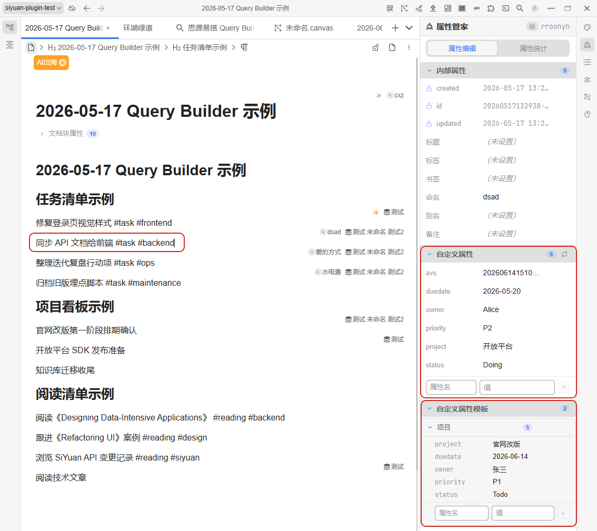
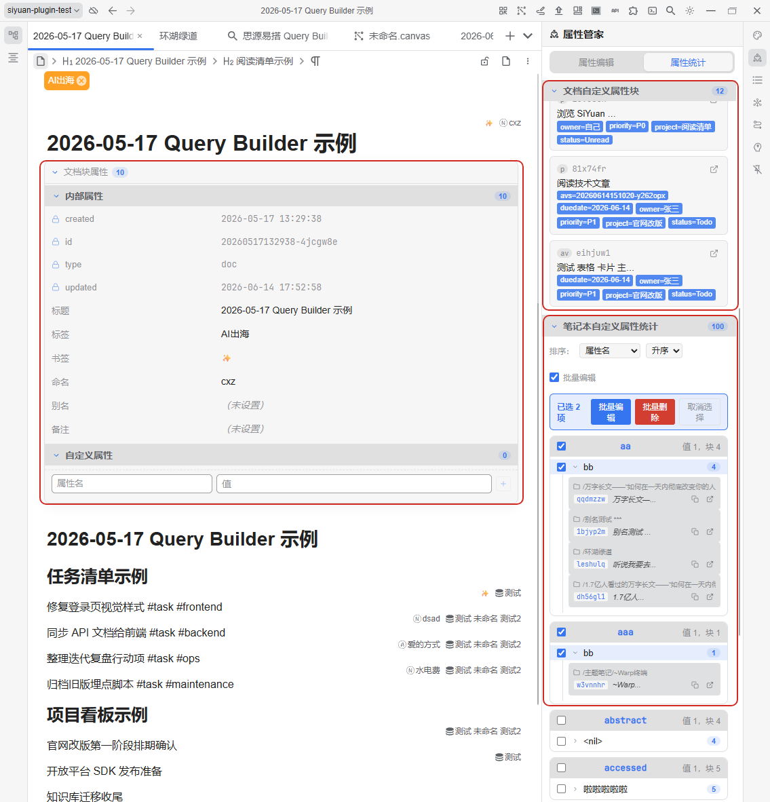
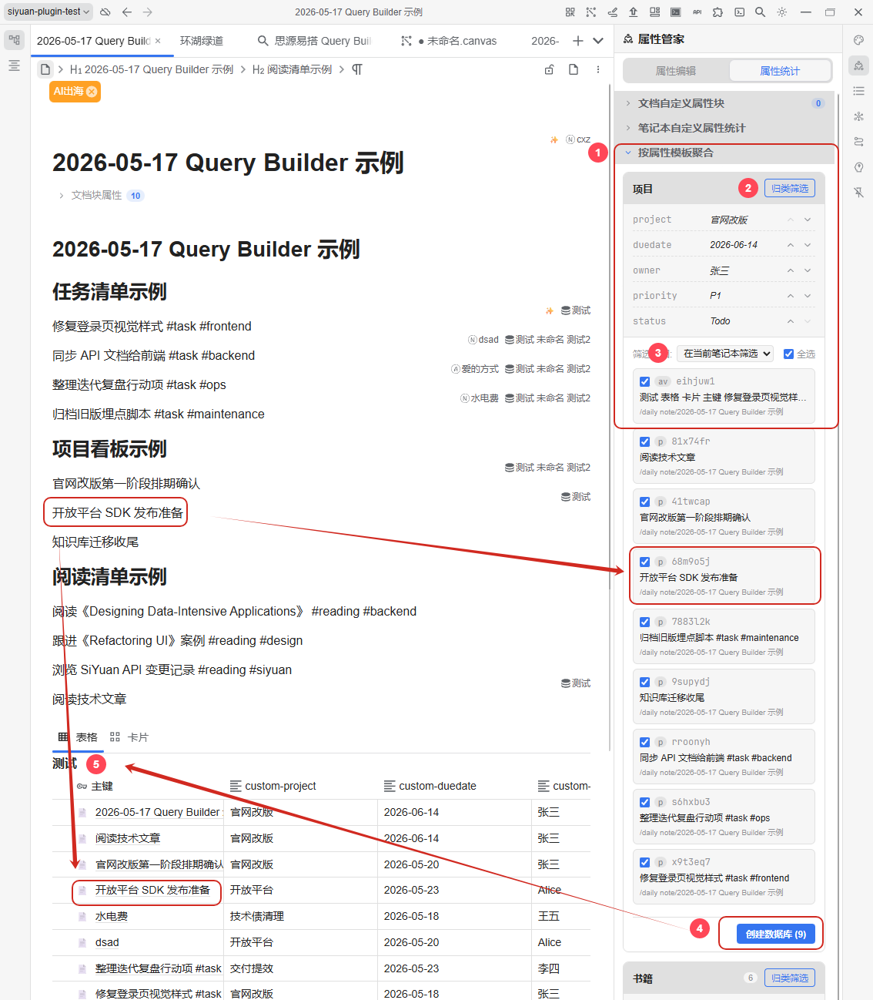
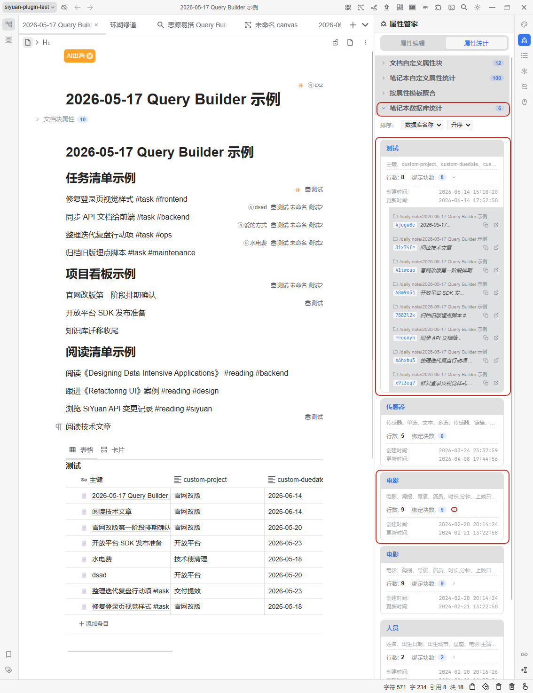

# 属性管家：自底向上的维护笔记属性，水到渠成时构建数据库

~思源笔记 思源笔记插件开发实践  [*](https://ld246.com/article/1781848253163)

## 楔子：从“易搭”到“属性管家”

“属性管家”插件是开发另一个“易搭”插件时的副产品，“易搭”插件希望能让小白用户不用懂SQL就可以去探索思源笔记底层的SQLite数据库（[神秘插件 C - 链滴](https://ld246.com/article/1779010616371)），并预置了一些日常查询场景（比如，最近X天新建/更新文档、笔记随机漫游、无链接孤岛笔记查询等），用户改改查询条件就能实现一些定制化的笔记查询需求。

其中一类使用场景是基于思源笔记的块属性来实现简单的项目看板，包括任务进度、读书计划等。但问题是自定义属性配置过于繁琐，思源笔记并没有提供一个常驻的属性配置面板来实现便捷的编辑，也没有提供统一的入口来查看和访问当前文档和当前笔记本的自定义属性块。如果不解决自定义属性编辑便利性的问题，这类场景实际上就用不起来。

‍

## 属性管家：自底向上的维护属性，水到渠成时构建数据库

### 属性编辑：便捷维护自定义属性

因此，我开发了“属性管家”插件，提供一个常驻的侧边栏，可以快速编辑当前光标所在块的自定义属性。为了方便批量增加自定义属性，提供模板功能，可以一键将模板包含的属性集“粘贴”到当前块。

除了属性快捷编辑功能，还做了属性统计tab，方便查看、访问和编辑本文档和当前笔记本所有的自定义属性块，支持一键跳转和批量编辑：

### 属性统计：全局可视易管理，丝滑过渡“数据库”

最近，对这个帖子（[提案：基于内部块属性支持文档级 Frontmatter - 链滴](https://ld246.com/article/1780601528021)）中提到的“很多时候人们本质只是需要一个文档 frontmatter，却被迫去创建了思源的数据库”深有共鸣，进一步开发了基于自定义属性块创建数据库的功能。

自定义属性和数据库特性不冲突，还没想清楚时不必急着构建重量级的数据库，按“够用”原则维护少量自定义属性就好，等到积累了一些自定义属性块，管理维度比较稳定了，管理范围扩展到一定程度了，再基于现有的自定义属性块构建数据库也不迟。

与自定义属性管理类似，属性管家还提供了当前笔记本所有数据库统计的视图，让已创建的数据库全局可视，支持快速跳转访问关联块：

‍

在我的设想中，属性管家的“属性编辑”功能解决自定义属性编辑操作繁琐、无法持续的问题，“属性统计”解决自定义属性和数据库散落不方便管理维护的问题，“按模板聚合自定义属性块，一键创建数据库”功能让用户可以随时从自定义属性块升级到使用思源笔记数据库特性管理项目状态，让之前积累维护自定义属性工作不白费。

如果你对维护自定义属性的热情难以维系，如果你对是不是要用上重量级的“数据库”特性而心有疑虑，如果你不想因为三分钟热情然后落入白费功夫的窘境——属性管家可以帮助你自底向上的用自定义属性维护资料，水到渠成时再构建数据库。

‍

## 附录

- [神秘插件 C - 链滴](https://ld246.com/article/1779010616371) *
- [为了让思源笔记用起来更顺手，我打算开发 10 个插件，目前进度…… - 链滴](https://ld246.com/article/1775894033664) *
