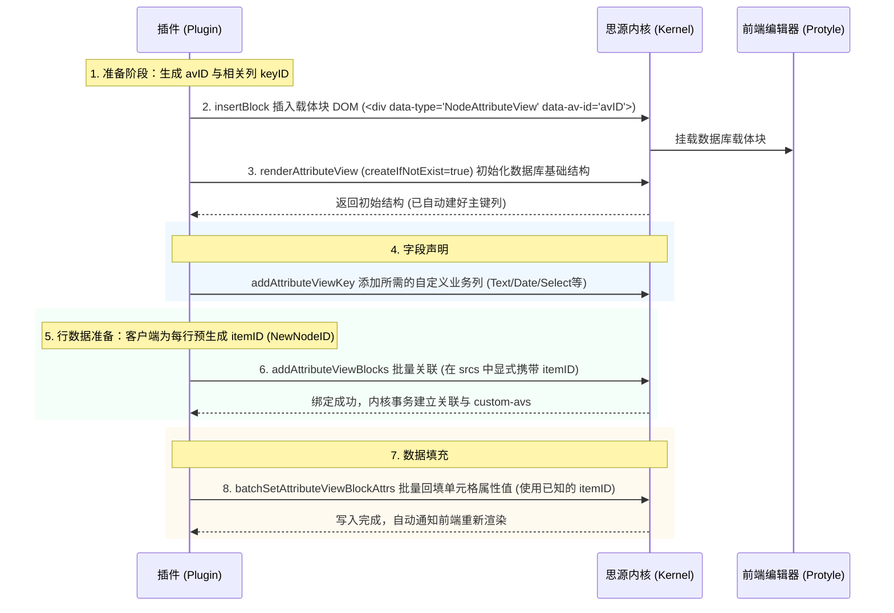

# 思源笔记属性视图 (Attribute View / 数据库) 开发指南

本指南依据思源笔记内核源码（Go 后端 `kernel/av/` 与 `kernel/model/attribute_view*.go`，前端 `app/src/`）梳理并核实，总结了思源笔记**属性视图（Attribute View / 简称 AV，即数据库）**的核心数据架构、存储规范、支持的字段类型与数据载荷结构、官方 API 接口要点、最佳调用时序及常见避坑指南。

---

## 1. 核心概念与工作机制

思源笔记的属性视图（Attribute View）提供类似 Notion Database 的结构化多维表格与多重视图能力：

1. **载体块（Database Carrier Block）**：
   - 属性视图在文档树中以 `NodeAttributeView` 类型的块节点存在。
   - DOM 结构标识形如：`<div data-type="NodeAttributeView" data-av-id="{avID}" data-av-type="table"></div>`。
2. **条目类型（行记录）**：
   - **绑定条目（Bound Block）**：主键关联真实的笔记内容块（如段落、文档、列表项等）。绑定后，内核会在被绑定的内容块 IAL 属性中写入 `custom-avs="{avID}"`（多个以逗号分隔）；修改或删除行记录不会删除源内容块，但解除绑定会清理对应的 `custom-avs`。
   - **游离条目（Detached Block）**：仅存在于当前属性视图数据库内部的虚拟行记录，不对应任何外部笔记内容块（`block.id` 为空）。
3. **数据独立性说明（重要澄清）**：
   - 属性视图的列（字段）值均保存在数据库本身的存储文件中，**不会**自动双向同步写回绑定块的 `custom-xxx` IAL 块属性中。
   - 数据库列名（`key.name`）为普通显示名称，**无需也不应该强制添加 `custom-` 前缀**。列名无论是否带 `custom-`，都不会改变字段的存储机制；行记录是绑定还是游离完全由主键行的 `isDetached` 决定。
   - （注：块属性中的 `custom-` 仅在数据库自动化与收集规则 `AutomationBlockSource.Attributes` 中作为块收集的过滤匹配条件使用）。

---

## 2. 数据架构与 AV JSON 规范

### 2.1 存储位置与版本演进

* **存储路径**：
  * 普通工作空间：`/data/storage/av/{avID}.json`
  * 加密笔记本内：`/data/{boxID}/storage/av/{avID}.json`（经底层加密存储，禁止直接使用文件覆盖方式操作）
* **格式版本（Spec）**：
  * 早期版本为 Spec 4；当前内核规范为 **`CurrentSpec = 14`**。
  * 关键版本节点：`PlainTextSpec = 8`、`RichTextSpec = 9`（支持富文本）、`LocationSpec = 13`（支持地理位置）、`SubItemsSpec = 14`（支持子条目层级树）。

### 2.2 核心 JSON 根结构

```json
{
  "spec": 14,
  "id": "20261115120000-avid123",
  "name": "任务管理数据库",
  "keyValues": [ ... ],
  "keyIDs": ["key-id-1", "key-id-2"],
  "views": [ ... ],
  "newItemTemplates": [ ... ],
  "automations": { ... },
  "subItems": { ... }
}
```

| 字段名 | 类型 | 说明 |
| :--- | :--- | :--- |
| `spec` | `number` | 数据库格式版本，当前最新为 `14` |
| `id` | `string` | 属性视图唯一标识符（`avID`） |
| `name` | `string` | 数据库名称 |
| `keyValues` | `Array` | 包含所有列定义（`key`）与该列所有单元格值（`values`）的数组 |
| `keyIDs` | `Array<string>` | 全局列显示顺序的 `key.id` 列表 |
| `views` | `Array` | 视图配置列表（包含表格、看板、画册、列表、日历等视图类型） |
| `newItemTemplates` | `Array` | 新增条目模板（支持直接创建为文档或游离条目，设置默认字段值等） |
| `automations` | `Object` | 自动化与自动收集规则（可选） |
| `subItems` | `Object` | 树形层级子任务配置（可选） |

### 2.3 视图类型（LayoutType）

内核支持以下 5 种布局类型：
* `table`：多维表格
* `kanban`：看板视图
* `gallery`：卡片画册视图
* `list`：列表视图
* `calendar`：日历视图
*(注：旧版的 `map` 地图视图在 Spec 13 已退役，仅保留历史兼容占位)*

### 2.4 字段类型（KeyType）

思源内核目前支持 18 种原生字段类型：

| `KeyType` 标识 | 中文名称 | 说明与特有配置 |
| :--- | :--- | :--- |
| `block` | **主键** | 数据库的唯一主键列，存储绑定块引用或游离条目标题 |
| `text` | 文本 | 支持纯文本或 Kramdown 富文本 (`rich: { spec: 1, format: "kramdown", content: "..." }`) |
| `number` | 数字 | 支持 `numberFormat` 格式化配置 |
| `date` | 日期 | 支持时间区间、具体时间开关、`dateFormat` 显示格式配置 |
| `select` | 单选 | 包含 `options: [{ name, color, desc }]` 选项配置 |
| `mSelect` | 多选 | 与单选共享选项池，单元格可包含多个选项 |
| `url` | 网址 | 超链接 |
| `email` | 邮箱 | 电子邮件地址 |
| `phone` | 电话 | 电话号码 |
| `location` | 位置 | WGS84 经纬度与地名 (`{ name, latitude, longitude }`) |
| `mAsset` | 资源/附件 | 文件或图片资产列表 (`[{ type, name, content }]`) |
| `template` | 计算模板 | 支持计算公式与模板表达式 |
| `created` | 创建时间 | 自动维护的条目创建时间戳，可配置是否显示时间 |
| `updated` | 更新时间 | 自动维护的条目修改时间戳，可配置是否显示时间 |
| `checkbox` | 复选框 | 布尔勾选状态 (`{ checked: boolean }`) |
| `relation` | 关联 | 关联其他数据库的条目，支持单向/双向关联与反向列 |
| `rollup` | 汇总 | 基于 `relation` 关联列对目标数据库指定字段进行汇总统计 |
| `lineNumber`| 行号 | 自动计算的行序号 |

### 2.5 单元格数据结构（`Value`）与更新载荷

在 `keyValues` 数组中，每个列定义包含其所有的单元格值：

```json
{
  "key": {
    "id": "20261115120000-col001",
    "name": "优先级",
    "type": "select",
    "options": [
      { "name": "紧急", "color": "1" },
      { "name": "普通", "color": "3" }
    ]
  },
  "values": [
    {
      "id": "20261115120000-val001",
      "keyID": "20261115120000-col001",
      "blockID": "20261115120000-row001", // 数据库行记录 ID (即 itemID)
      "type": "select",
      "mSelect": [
        { "content": "紧急", "color": "1" }
      ]
    }
  ]
}
```

#### 各类型在写入时的 `value` 载荷示例：

* **文本 (Text)**:
  ```json
  { "text": { "content": "任务描述内容" } }
  // 或者富文本格式：
  { "text": { "content": "加粗文本", "rich": { "spec": 1, "format": "kramdown", "content": "**加粗文本**" } } }
  ```
* **数字 (Number)**:
  ```json
  { "number": { "content": 99.5, "isNotEmpty": true } }
  ```
* **日期 (Date)**:
  ```json
  { "date": { "content": 1715000000000, "isNotEmpty": true, "hasEndDate": false, "isNotTime": false } }
  ```
* **单选 / 多选 (Select / MSelect)**:
  ```json
  { "mSelect": [{ "content": "紧急", "color": "1" }] }
  ```
  *(注：颜色索引为内置调色板序号字符串 `"1"` ~ `"14"`，如果传入新选项名称，内核会自动将该选项加入列定义中)*
* **复选框 (Checkbox)**:
  ```json
  { "checkbox": { "checked": true } }
  ```
* **网址 / 邮箱 / 电话**:
  ```json
  { "url": { "content": "https://b3log.org" } }
  { "email": { "content": "support@example.com" } }
  { "phone": { "content": "13800000000" } }
  ```
* **地理位置 (Location)**:
  ```json
  { "location": { "name": "北京国家会议中心", "latitude": 39.993, "longitude": 116.397 } }
  ```
* **关联 (Relation)**:
  ```json
  { "relation": { "blockIDs": ["target-item-id-1", "target-item-id-2"] } }
  ```

---

## 3. 核心 API 接口指南

插件与思源内核进行属性视图交互时，必须统一使用官方 HTTP 契约 API（全部为 `POST` 请求）：

### 3.1 数据库结构与生命周期

#### 1) 获取属性视图完整结构
* **接口路径**：`/api/av/getAttributeView`
* **请求参数**：
  ```json
  { "id": "avID" }
  ```
* **返回**：包含全部列定义、视图配置、模板的完整 `av` 对象。

#### 2) 渲染属性视图
* **接口路径**：`/api/av/renderAttributeView`
* **请求参数**：
  ```json
  {
    "id": "avID",
    "viewID": "viewID (可选)",
    "blockID": "databaseCarrierBlockID (可选)",
    "page": 1,
    "pageSize": 50,
    "createIfNotExist": true
  }
  ```
* **要点**：若传入 `createIfNotExist: true` 且该 `avID` 尚不存在，内核会自动为其生成默认的初始数据库文件及表格主键配置。

### 3.2 列（字段）管理

#### 1) 添加新列
* **接口路径**：`/api/av/addAttributeViewKey`
* **请求参数**：
  ```json
  {
    "avID": "avID",
    "keyID": "col-uuid (可自生成，如通过 Lute.NewNodeID())",
    "keyName": "截止日期",
    "keyType": "date",
    "keyIcon": "iconCalendar",
    "previousKeyID": "前一个列的ID (为空则加在末尾)"
  }
  ```

#### 2) 删除列
* **接口路径**：`/api/av/removeAttributeViewKey`
* **请求参数**：
  ```json
  {
    "avID": "avID",
    "keyID": "col-uuid",
    "removeRelationDest": false
  }
  ```

#### 3) 查询数据库列定义
* **接口路径**：`/api/av/getAttributeViewKeysByAvID`
* **请求参数**：`{ "avID": "avID" }`
* **返回**：`data: [{ "id": "...", "name": "...", "type": "...", "icon": "..." }, ...]`

### 3.3 行记录（条目）管理

#### 1) 批量添加/绑定内容块条目
* **接口路径**：`/api/av/addAttributeViewBlocks`
* **请求参数**：
  ```json
  {
    "avID": "avID",
    "srcs": [
      {
        "id": "真实笔记内容块ID-1",
        "itemID": "可选：预先指定的行记录ID-1",
        "isDetached": false
      },
      {
        "id": "",
        "itemID": "可选：预先指定的行记录ID-2",
        "content": "游离行标题内容",
        "isDetached": true
      }
    ],
    "previousID": "前一行的itemID (可选)",
    "ignoreDefaultFill": false
  }
  ```
* **关键特性**：
  - 调用方可以在 `srcs` 中**直接提供 `itemID`**。若提供了 `itemID`，内核将直接采用该 ID 作为该行的唯一主键标识，调用方即可在下一步立即使用此 ID 写入单元格，无需任何异步轮询或反查！
  - 若未提供 `itemID`，内核会自动为每行生成唯一 ID。

#### 2) 批量反查映射：真实块 ID ↔ 行记录 ID
如果添加块时未显式指定 `itemID`，可通过官方提供的专用反查接口获取映射：
* **根据真实块 ID 查询行记录 ID**：
  * **接口路径**：`/api/av/getAttributeViewItemIDsByBoundIDs`
  * **请求参数**：
    ```json
    {
      "avID": "avID",
      "blockIDs": ["真实块ID-1", "真实块ID-2"]
    }
    ```
  * **返回**：`{ "code": 0, "data": { "真实块ID-1": "行记录ID-1", "真实块ID-2": "行记录ID-2" } }`
* **根据行记录 ID 查询真实块 ID**：
  * **接口路径**：`/api/av/getAttributeViewBoundBlockIDsByItemIDs`
  * **请求参数**：`{ "avID": "avID", "itemIDs": ["行记录ID-1"] }`
  * **返回**：`{ "code": 0, "data": { "行记录ID-1": "真实块ID-1" } }`

#### 3) 一步追加带数据的游离行
* **接口路径**：`/api/av/appendAttributeViewDetachedBlocksWithValues`
* **用途**：若仅需批量导入虚拟数据（非绑定真实块），可直接调用此接口一次性传入每行每列的具体值，一步完成建行与填值。

### 3.4 单元格数据读写

> [!WARNING]
> **参数名称重要警示**：
> 标识行记录的参数键名必须为 **`itemID`**！
> 旧版代码中出现的 `rowID` 参数已在思源内核 Issue #15727 中被明确**废弃**。在当前内核版本中如果传入 `rowID`，接口将直接报错拒绝执行。

#### 1) 单个更新单元格
* **接口路径**：`/api/av/setAttributeViewBlockAttr`
* **请求参数**：
  ```json
  {
    "avID": "avID",
    "keyID": "colKeyID",
    "itemID": "rowItemID",
    "value": {
      "text": { "content": "新文本内容" }
    }
  }
  ```

#### 2) 批量更新单元格
* **接口路径**：`/api/av/batchSetAttributeViewBlockAttrs`
* **请求参数**：
  ```json
  {
    "avID": "avID",
    "values": [
      {
        "keyID": "colKeyID-1",
        "itemID": "rowItemID-1",
        "value": { "number": { "content": 100, "isNotEmpty": true } }
      },
      {
        "keyID": "colKeyID-2",
        "itemID": "rowItemID-1",
        "value": { "mSelect": [{ "content": "进行中", "color": "2" }] }
      }
    ]
  }
  ```

---

## 4. 推荐开发流程与调用时序

在插件中动态创建属性视图并填充数据的标准时序推荐如下（推荐采用**客户端预生成 `itemID`** 模式，实现零延时、零文件读写、无竞态的高性能批量处理）：

### 🛠️ 最佳开发时序图 (Mermaid)



### 关键步骤要点：

1. **预先生成 `itemID` 优势**：
   - 在前端或插件端，每个 ID 本质上是一个符合节点规则的时间戳格式字符串（可直接调用 `Lute.NewNodeID()` 或通过常用算法生成）。
   - 在 `addAttributeViewBlocks` 的 `srcs` 元素中直接附带 `itemID: myID`。这样插件天然掌握 `boundBlockID` 与 `itemID` 的精确对应关系，无需在调用后通过任何延时等待去读取文件或调用额外接口进行映射反查。
2. **无需额外延时（Sleep）**：
   - 弃用旧文档中等待磁盘持久化的 `setTimeout(200ms)` 操作。思源内核对于 `addAttributeViewBlocks` 和 `batchSetAttributeViewBlockAttrs` 均具有完整的事务性保护与内存缓存同步机制，前一个 API 调用返回成功后，下一个 API 可立即串行发起。
3. **备用反查机制**：
   - 如果数据源是由用户在 UI 手动绑定或历史已存在的数据库，若未知其 `itemID`，直接调用 `/api/av/getAttributeViewItemIDsByBoundIDs` 即可一步获得映射表，切忌调用 `getFile` 读取底层 JSON 解析。

---

## 5. 开发者防坑指南与常见限制

* **严禁使用 `rowID` 参数**：
  在调用 `setAttributeViewBlockAttr` 或 `batchSetAttributeViewBlockAttrs` 时，行主键参数必须写为 `itemID`。传入 `rowID` 将导致内核直接报错拦截。
* **不要尝试通过数据库列修改块 IAL 自定义属性**：
  属性视图的字段值仅存在于 AV 数据体系中，与块上的 `custom-xxx` IAL 并不共享。试图通过给列命名为 `custom-xxx` 来实现双向属性同步是无效的。如果需要修改内容块本身的 IAL 属性，请直接调用 `/api/attr/setBlockAttrs`。
* **加密笔记本（Encrypted Box）安全机制**：
  在加密笔记本中，数据库文件保存在特定笔记本目录下并受密匙加密，直接调用 `/api/file/putFile` 或 `/api/file/getFile` 操作底层文件会导致数据损坏或无法通过解密校验。任何时候都应使用标准 `/api/av/*` 接口由内核代管加密与存储。
* **单选与多选列自动补充选项**：
  当调用批量更新接口向 `select` 或 `mSelect` 列写入值时，如果写入的选项内容不在列当前的 `options` 列表中，内核会自动将该文本添加到选项定义中，并随机赋予预置调色板颜色序号（1-14）。调用方无需强制先调用修改选项配置接口再写值。
* **删除与解绑行为的区分**：
  - 从属性视图中移除行记录（`/api/av/removeAttributeViewBlocks`），对于绑定块仅仅是解除了关联关系并清理了该块上的 `custom-avs` 标记，**绝对不会**删除笔记中的原内容块。
  - 对于游离条目，由于其数据仅保存在该 AV 中，移除后其行数据将被永久删除。
* **富文本格式要求**：
  若向 `text` 字段写入富文本，格式必须严格遵守 Kramdown 规范（`rich: { spec: 1, format: "kramdown", content: "..." }`），否则可能触发内核规范校验错误。纯文本更新只需填充 `text: { content: "..." }` 即可。
